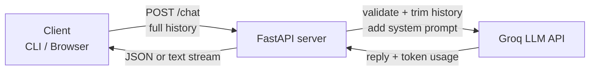

# AI Chatbot API

A production-style REST API for AI text applications, built with **FastAPI** and served by fast open-weight LLMs on **Groq**. It includes a multi-turn chatbot with real-time streaming and an email generator that returns schema-validated structured output, with input validation, context-window management and clear error handling throughout.


## Features

- **Multi-turn chat**: `POST /chat` takes the full conversation and returns the reply with token usage.
- **Streaming responses**: `POST /chat/stream` sends text as it is generated, for a faster-feeling UI.
- **AI email generator**: `POST /email/generate` turns a purpose and key points into a complete email, returned as structured JSON (subject, greeting, body, closing).
- **Structured outputs**: the model is constrained to a JSON Schema generated from a Pydantic model, and every response is validated again before it is returned, with one automatic retry.
- **Context management**: only the most recent messages are sent to the model, keeping cost and latency under control.
- **Input validation**: Pydantic schemas reject malformed requests with a `422` before any model call is made.
- **Clear error handling**: provider failures are mapped to meaningful HTTP status codes (`400`, `429`, `502`, `503`).
- **Configurable**: model, history length and system prompt are set through environment variables, so the model can be swapped without code changes.
- **Interactive docs**: auto-generated Swagger UI at `/docs`.
- **Terminal client**: a small CLI client for chatting with the API, with optional streaming.

## Architecture



LLM APIs are stateless: the model does not remember earlier requests. The client keeps the conversation and sends it with every request; the server validates it, keeps the last `MAX_HISTORY` messages and adds the system prompt before calling the model.

## Tech stack

| Layer | Technology |
|---|---|
| API framework | FastAPI |
| Server | Uvicorn (ASGI) |
| Validation | Pydantic v2 |
| LLM provider | Groq (OpenAI-compatible API) |
| Default model | `openai/gpt-oss-20b` |
| HTTP client | httpx |

## Getting started

### Prerequisites

- Python 3.10 or newer
- A free Groq API key from [console.groq.com](https://console.groq.com) (no credit card required)

### Installation

```bash
git clone https://github.com/<your-username>/ai-chatbot-api.git
cd ai-chatbot-api

python -m venv venv
# Windows
venv\Scripts\activate
# macOS / Linux
source venv/bin/activate

pip install -r requirements.txt
```

### Configuration

Copy the example settings file and add your key:

```bash
# Windows
copy .env.example .env
# macOS / Linux
cp .env.example .env
```

| Variable | Description | Default |
|---|---|---|
| `GROQ_API_KEY` | Your Groq API key (required) | none |
| `MODEL` | Groq model ID | `openai/gpt-oss-20b` |
| `MAX_HISTORY` | Number of recent messages sent to the model | `20` |
| `SYSTEM_PROMPT` | Instructions that set the assistant's behaviour | friendly, concise assistant |

### Run

```bash
uvicorn main:app --reload
```

The API runs at `http://localhost:8000`, and the interactive docs are at `http://localhost:8000/docs`.

To chat from the terminal, run this in a second terminal:

```bash
python chat_client.py            # full replies with token counts
python chat_client.py --stream   # streaming replies
```

## API reference

### `GET /health`

Returns the server status and the configured model.

```json
{ "status": "ok", "model": "openai/gpt-oss-20b" }
```

### `POST /chat`

Request:

```json
{
  "messages": [
    { "role": "user", "content": "What is a token?" }
  ],
  "temperature": 0.7,
  "max_tokens": 1024
}
```

| Field | Type | Rules |
|---|---|---|
| `messages` | list | At least one message; the last must have role `user` |
| `messages[].role` | string | `user` or `assistant` |
| `messages[].content` | string | 1 to 20,000 characters |
| `temperature` | number | 0.0 to 2.0, default 0.7 |
| `max_tokens` | integer | 1 to 4096, default 1024 |

Response:

```json
{
  "reply": "A token is a small chunk of text that a language model reads and writes...",
  "model": "openai/gpt-oss-20b",
  "input_tokens": 42,
  "output_tokens": 57,
  "messages_sent": 1
}
```

### `POST /chat/stream`

Same request body as `/chat`. Returns the reply as a plain-text stream.

### `POST /email/generate`

Request:

```json
{
  "recipient": "my manager Priya",
  "purpose": "Ask for leave on Friday",
  "key_points": ["family function in Hyderabad", "work will be handed over to Ravi"],
  "tone": "formal",
  "length": "short",
  "sender_name": "Anushka"
}
```

| Field | Type | Rules |
|---|---|---|
| `recipient` | string | 1 to 200 characters |
| `purpose` | string | 5 to 1,000 characters |
| `key_points` | list of strings | Optional, up to 10 |
| `tone` | string | `formal`, `friendly`, `persuasive` or `apologetic`; default `formal` |
| `length` | string | `short`, `medium` or `long`; default `medium` |
| `sender_name` | string | Optional |

Response:

```json
{
  "email": {
    "subject": "Leave request for Friday",
    "greeting": "Dear Priya,",
    "body": "I would like to request leave this Friday...",
    "closing": "Best regards,\nAnushka",
    "tone": "formal"
  },
  "model": "openai/gpt-oss-20b",
  "input_tokens": 210,
  "output_tokens": 160,
  "attempts": 1
}
```

### Error responses

| Status | Meaning |
|---|---|
| `400` | The last message is not from the user |
| `422` | The request body failed validation |
| `429` | The provider's rate limit was reached |
| `500` | The server's API key is missing or invalid |
| `502` | The provider returned an error (for example, an unknown model) |
| `503` | The provider could not be reached |

## Project structure

```
ai-chatbot-api/
├── main.py            # FastAPI app: endpoints, validation, LLM calls
├── chat_client.py     # Terminal client that keeps conversation history
├── requirements.txt   # Pinned dependencies
├── .env.example       # Settings template (copy to .env)
├── .gitignore
├── LICENSE
└── README.md
```

## Design decisions

- **Client-side history.** Keeping the conversation on the client keeps the server stateless and easy to scale; the trade-off is that every request resends the history, which `MAX_HISTORY` bounds.
- **Provider-agnostic configuration.** The model ID lives in `.env`, so a retired or replaced model can be swapped without touching code.
- **Fail fast.** Validation runs before the model call, so malformed requests never spend tokens.
- **Validate model output, not just input.** Even with strict structured outputs, the reply is parsed with the same Pydantic model before it reaches the client, and an invalid reply triggers one retry.
- **Async I/O.** Endpoints are `async`, so the server keeps handling other requests while waiting on the model.

## Roadmap

- [ ] Persist conversations in a database
- [ ] Authentication with API keys
- [ ] Response caching with Redis
- [ ] Docker image and cloud deployment
- [ ] Structured logging and request metrics
- [ ] Automated tests

## License

This project is licensed under the MIT License. See [LICENSE](LICENSE) for details.
